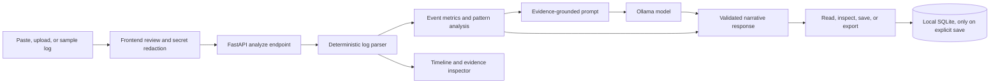

# GhostTrace 👻

> **Every command leaves a trace. Some traces tell stories.**

[](https://github.com/ayusharyan4269-bit/GhostTrace/actions/workflows/ci.yml)
[](https://www.python.org/)
[](https://react.dev/)
[](https://ollama.com/)
[](LICENSE)

GhostTrace is a local-first log analysis app for developers. It accepts terminal output, application logs, or sample scenarios, extracts verifiable events, detects patterns, and asks a locally configured Ollama language model to turn those findings into a narrative or investigation report.

The project deliberately separates **what the log proves** from **how the story describes it**. Parsing, counts, event references, and evidence links are produced by application code. The model adds style and interpretation; its technical claims should be checked against the cited source lines.

## Why GhostTrace?

Logs are useful but often difficult to scan. GhostTrace makes a trace easier to explore by combining a deterministic timeline with a readable narrative. It can help with:

- spotting repeated failures, warnings, process events, and suspicious sequences;
- following a narrative reference back to the exact source line;
- comparing a technical incident report with more creative storytelling modes;
- sharing a saved analysis as Markdown without copying raw logs into a report by hand.

GhostTrace is an exploratory analysis and storytelling aid. It is not a replacement for monitoring, an incident response platform, or a security verdict.

## What it does

| Feature | What it does | Why it is useful |
| --- | --- | --- |
| Paste logs | Analyze terminal output directly in the editor, with an input-size limit. | Fast checks without preparing a file. |
| Upload logs | Load supported text, log, JSON, or CSV files. | Work with an existing trace. |
| Built-in scenarios | Load fictional sample traces such as *The Midnight Process*, *The Forgotten Server*, and *The Last Commit*. | Try the interface without using private or production logs. |
| Deterministic parser | Extracts event lines, line references, timestamps, levels, and recognized signals from supported log formats. | Gives the timeline and evidence inspector a source of truth independent of the model. |
| Event analysis | Calculates summary metrics and identifies patterns such as repeated errors and restart sequences. | Makes important structure visible before reading the narrative. |
| Narrative modes | Produces one of four styles: Haunted Chronicle, Digital Séance, Forensic Detective, or Lost Memory. | Lets the same evidence be explored in different tones. |
| Evidence inspector | Opens the verbatim source line and parser-detected signals for a cited event. | Helps verify narrative statements against the original trace. |
| Secret redaction preview | Recognized credential-like values are redacted before analysis, with a review step in the UI. | Reduces accidental disclosure of common secret formats. This is best-effort pattern matching, not a guarantee. |
| Saved sessions | Saves the generated narrative and analysis summary to a local SQLite database when explicitly requested. | Return to a result without storing every input automatically. |
| Markdown export | Downloads the current report and evidence references as Markdown. | Keep or share a readable report. Review it before sharing. |
| Local model status | Shows whether Ollama and the selected model are available. | Makes the AI runtime dependency visible. |

## How it works



### Analysis workflow

1. **Input:** Paste terminal output, upload a supported file, or choose a built-in scenario.
2. **Review and redact:** GhostTrace checks for common credential patterns. If a possible secret is found, review the redacted preview before continuing. Custom or unusual secrets may not be detected.
3. **Parse:** The backend reads the submitted content as data. It does not execute commands or attach to a shell. It extracts structured events from plain text and supported JSON/NDJSON/CSV input.
4. **Analyze:** Deterministic code calculates metrics and detects supported event patterns. These results do not depend on the language model.
5. **Generate:** The backend sends the parsed evidence and requested style to the configured Ollama model. Logs are treated as untrusted content; model output is validated and reconciled with known event references.
6. **Inspect:** Read the narrative and timeline. Open event citations to see the corresponding source line and detected signals. Treat creative details as storytelling unless supported by evidence.
7. **Keep or export:** Choose **Save Session** to store the result in the configured local SQLite database, or export a Markdown report. Raw input logs are not saved as part of the normal session workflow.

If Ollama is unavailable, GhostTrace can still parse and display deterministic event analysis; narrative generation will report an error.

## Narrative modes

| Mode | Style | Intended use |
| --- | --- | --- |
| **Haunted Chronicle** | Atmospheric gothic horror. | A creative retelling of failures, processes, and system events. |
| **Digital Séance** | The machine speaks in first person. | A fictional voice for a trace or abandoned system. |
| **Forensic Detective** | Technical noir, evidence-first. | A readable incident narrative that highlights sequence, hypotheses, and unknowns. |
| **Lost Memory** | Reflective and poetic. | A tribute to developer work and unfinished digital artifacts. |

The mode changes presentation, not the underlying parsed evidence. AI-generated explanations can still be mistaken; verify technical conclusions against the log.

## Technology

- **Frontend:** React 18, TypeScript, Vite, Tailwind CSS, Vitest, and Testing Library.
- **Backend:** Python 3.11+, FastAPI, Pydantic, HTTPX, and pytest.
- **AI runtime:** Ollama's local HTTP API. Default model: `qwen2.5:3b`.
- **Storage:** SQLite for explicitly saved analysis sessions.
- **Automation:** GitHub Actions runs backend tests, frontend tests, and a frontend production build for pushes and pull requests.

## Requirements

- Python 3.11 or later
- Node.js 20 recommended (18+ may work) and npm
- [Ollama](https://ollama.com/download) for narrative generation
- A compatible model downloaded in Ollama, such as `qwen2.5:3b`

The deterministic parser and timeline can be used when Ollama is stopped, but AI narrative generation needs a reachable Ollama server and an installed model.

## Run locally on Windows

### 1. Download a model and start Ollama

Install Ollama, then in a terminal run:

```powershell
ollama pull qwen2.5:3b
```

Ollama normally runs as a background service on `http://127.0.0.1:11434`. If it is not running automatically, start it in a separate terminal with `ollama serve`.

### 2. Install backend dependencies

From the repository root:

```powershell
cd backend
python -m venv .venv
.\.venv\Scripts\Activate.ps1
python -m pip install -r requirements.txt
cd ..
```

### 3. Install frontend dependencies

```powershell
cd frontend
npm ci
cd ..
```

### 4. Start the app

From the repository root, run:

```powershell
.\dev.ps1
```

The helper opens backend and frontend terminals. When Vite is ready, open **http://localhost:5173**. The backend API is at **http://127.0.0.1:8000** and interactive API docs are at **http://127.0.0.1:8000/docs**.

If you prefer to start services manually, use two terminals from the repository root.

Backend terminal:

```powershell
cd backend
.\.venv\Scripts\Activate.ps1
$env:PYTHONPATH = "."
uvicorn app.main:app --host 127.0.0.1 --port 8000 --reload
```

Frontend terminal:

```powershell
cd frontend
npm run dev
```

## Configure GhostTrace

The defaults are suitable for local development. To override them, copy `.env.example` to `.env` at the project root or copy `backend/.env.example` to `backend/.env`, then edit the values and restart the backend.

| Variable | Default | Purpose |
| --- | --- | --- |
| `OLLAMA_BASE_URL` | `http://127.0.0.1:11434` | Ollama server address. A remote address means submitted, redacted log content is sent to that server. |
| `OLLAMA_MODEL` | `qwen2.5:3b` | Model tag to request from Ollama. The model must already be available there. |
| `OLLAMA_TIMEOUT_SECONDS` | `75.0` | Maximum time to wait for inference. |
| `MAX_INPUT_CHAR_LIMIT` | `150000` | Maximum accepted log content length. |
| `DB_PATH` | `backend/ghosttrace.db` | SQLite file used for saved sessions. |
| `DEBUG` | `false` | Backend debug setting. Keep disabled for normal use. |

Example of choosing another model: first download the model through Ollama, then set `OLLAMA_MODEL` to its exact tag. Availability and output quality depend on the model and the machine running Ollama.

## API overview

The backend exposes these routes under `/api`:

| Method | Route | Purpose |
| --- | --- | --- |
| `GET` | `/api/health` | Backend version and Ollama/model availability. |
| `GET` | `/api/models` | Configured model and models reported by Ollama. |
| `GET` | `/api/scenarios` | Built-in sample logs. |
| `POST` | `/api/analyze` | Redact recognized secrets, parse and analyze log content, and request a narrative. |
| `GET` | `/api/sessions` | List explicitly saved sessions. |
| `POST` | `/api/sessions` | Save a session. |
| `GET` | `/api/sessions/{session_id}` | Read a saved session. |
| `PATCH` | `/api/sessions/{session_id}` | Update supported saved-session fields. |
| `DELETE` | `/api/sessions/{session_id}` | Delete one saved session. |
| `DELETE` | `/api/sessions` | Clear saved sessions. |

Open **http://127.0.0.1:8000/docs** while the backend is running for request and response schemas.

## Privacy and security

- GhostTrace does not execute submitted commands and does not monitor shell history.
- Ollama is configured to use localhost by default. If you change `OLLAMA_BASE_URL` to a remote server, the analyzed content (after detected-secret redaction) is sent there for inference; use a server you trust.
- There is no hosted AI fallback configured by the app.
- Pasted and uploaded content is processed for the request and is not written to the session database by default. Saving a session stores the narrative and analysis fields; raw logs are not intended to be persisted.
- Common credential patterns are redacted before analysis, but pattern matching can miss secrets. Review the preview and avoid using real credentials in tests.
- Logs are untrusted input. Prompt guardrails and response validation reduce risks but do not make model output authoritative or guarantee that every malicious instruction is ignored.
- Markdown exports can contain information from the analysis. Inspect an export before sharing it.

## Tests and build

Run the backend tests from the repository root after installing backend requirements:

```powershell
python -m pytest -q backend/tests
```

Run frontend tests and production build:

```powershell
cd frontend
npm test
npm run build
```

`npm run lint` runs the TypeScript compiler without emitting files. GitHub Actions runs the backend test suite, frontend test suite, and production build automatically on pushes and pull requests. See [`.github/workflows/ci.yml`](.github/workflows/ci.yml).

For a manual end-to-end browser checklist, see [`docs/SMOKE_TEST.md`](docs/SMOKE_TEST.md). For component details and data flows, see [`docs/ARCHITECTURE.md`](docs/ARCHITECTURE.md).

## Troubleshooting

| Symptom | What to check |
| --- | --- |
| Browser is blank or cannot connect | Confirm both backend and Vite terminals are running. Open the Vite URL printed in the terminal, usually `http://localhost:5173`. Check browser DevTools Console and the Vite terminal for an actual error. |
| Model badge is offline | Confirm Ollama is running; check `http://127.0.0.1:11434` and verify `ollama list` includes the configured model. |
| Model not found | Run `ollama pull qwen2.5:3b` or set `OLLAMA_MODEL` to a model tag installed in Ollama, then restart the backend. |
| Analysis has a timeline but no story | The deterministic analysis can succeed without inference. Check Ollama connectivity, model availability, and backend terminal output. |
| Input rejected | Check that the content is not empty and is below `MAX_INPUT_CHAR_LIMIT`. |
| Session history is empty | Sessions are only stored after using the explicit Save Session action. Confirm the backend can write to the configured database path. |

## Repository layout

```text
backend/                 FastAPI application, services, database, and backend tests
frontend/                React application, UI components, and frontend tests
.github/workflows/ci.yml GitHub Actions checks
docs/                    Architecture and manual testing guides
dev.ps1                  Windows helper to launch the local development app
```

## License

GhostTrace application code is released under the [MIT License](LICENSE). Ollama and the model are separate projects with their own terms and licenses; check the license for the exact model you download.

## Hacktoberfest

GhostTrace was prepared for the Hacktoberfest 2026 Open Source AI Challenge, Week 4 (*Ghost in the Machine*). Project submission notes are in [`docs/HACKTOBERFEST_WEEK4_SUBMISSION.md`](docs/HACKTOBERFEST_WEEK4_SUBMISSION.md).
