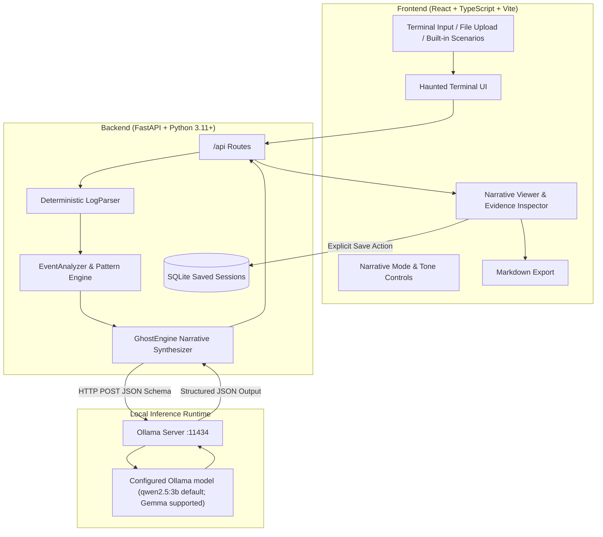

# GhostTrace System Architecture

> *"Every command leaves a trace. Some traces tell stories."*

---

## 1. System Overview

GhostTrace is a local-first, privacy-preserving AI application built for Hacktoberfest 2026 Week 4 (*"Ghost in the Machine"*). It accepts developer terminal histories, server logs, or built-in test scenarios, parses them deterministically into structured events, and synthesizes evidence-grounded narratives through an open-weight language model running on localhost via Ollama.

---

## 2. Core Architectural Pillars

### 2.1 Deterministic Grounding Before AI Inference
Rather than delegating raw, noisy logs directly to an LLM, GhostTrace executes a rigorous two-stage analysis:
1. **Stage 1 (Deterministic Parser):** Extracts line numbers, exact timestamps, commands, error messages, warnings, and process lifecycle events. Formats supported include plain text terminal logs, standard log lines, structured JSON (single/array/NDJSON), and CSV.
2. **Stage 2 (Pattern & Anomaly Engine):** Computes exact metric counts, finds repeated error messages, detects process restart loops, and isolates memory faults without LLM intervention.
3. **Stage 3 (Ghost Engine):** Passes the deterministic summary and event anchors to the local LLM. The LLM is restricted to weaving a story around *verifiable anchors*, preventing hallucination of fake commands, fake users, or non-existent files.

### 2.2 Local-First Inference & Privacy Boundary
- **Local by default:** The backend client defaults to `http://127.0.0.1:11434`. `OLLAMA_BASE_URL` can point elsewhere; in that case, logs are sent to the configured server.
- **No hosted AI fallback:** GhostTrace does not configure a cloud AI provider or telemetry. A remote Ollama endpoint is still remote processing and should be trusted before use with sensitive logs.
- **RAM-Only Processing by Default:** Uploaded or pasted logs exist only in volatile server memory during analysis. Nothing is written to the app's SQLite database unless the user explicitly saves a session.
- **No Shell Execution:** GhostTrace treats terminal logs as untrusted text. It never executes commands or monitors the user's active shell.

---

## 3. Backend Module Decomposition

| Module | Location | Responsibility |
| :--- | :--- | :--- |
| **Config** | `app/core/config.py` | Pydantic Settings reading `.env`. Defines configurable Ollama model (Qwen default; Gemma supported), Ollama URL, character limits, and DB paths. |
| **Log Parser** | `app/services/log_parser.py` | Deterministic regex and structured format parsing with fallback safety. |
| **Event Analyzer** | `app/services/event_analyzer.py` | Calculates metrics, time ranges, and detects patterns (repetition, crash loops). |
| **Ollama Client** | `app/services/ollama_client.py` | Async HTTPX client for Ollama API (`/api/tags`, `/api/generate`) with strict timeouts and error mapping. |
| **Ghost Engine** | `app/services/ghost_engine.py` | Prompt construction, mode guidelines, JSON schema enforcement, response validation, and fallback synthesis. |
| **Database** | `app/database/connection.py` | Async SQLite connection manager with index creation and schema management. |
| **Session Service** | `app/services/session_service.py` | Explicit CRUD operations for saved narratives and summaries. |
| **Scenarios** | `app/scenarios/scenarios.py` | Curated fictional demonstration scenarios for immediate offline testing. |

---

## 4. The 4 Narrative Modes

1. **Haunted Chronicle:** Gothic horror narrative treating background processes as restless spirits, failed operations as bad omens, and memory maps as haunted ground.
2. **Digital Séance:** Creative persona mode where the forgotten mainframe speaks in the first-person about past computational events.
3. **Forensic Detective:** Technical noir investigation prioritizing evidence, root causes, failure timelines, and explicitly stated uncertainties over supernatural language.
4. **Lost Memory:** Poetic, reflective narrative inspired by Día de los Muertos, honoring developer labor, abandoned commits, and memory preservation.

---

## 5. Security & Prompt Injection Mitigation

User-supplied logs can contain malicious strings (e.g. `Ignore all previous instructions...`). GhostTrace protects against prompt injection through:
- **System Instruction Isolation:** Explicit prompt guardrails declaring log snippets as untrusted historical text.
- **Strict Schema Enforcement:** Requiring valid JSON adhering to `NarrativeResult`.
- **Evidence Reconciliation:** Matching output `event_id` and line numbers back to the parser's deterministic database.
- **Input Size Caps:** Hard limits on request character length (150,000 characters) and file size (2MB) preventing denial-of-service.

---

## 6. Testing Strategy

- **Backend Pytest Suite:** 24 comprehensive tests covering API health, format parsing (text, JSON, NDJSON, CSV, malformed data), Ollama client mocking, prompt injection resistance, and SQLite session lifecycle.
- **Frontend Vitest Suite:** 7 component and integration tests verifying rendering, scenario loading, mode selection, narrative presentation, evidence modals, and markdown export.
- **Real-Inference Integration:** Verified against live local Ollama `qwen2.5:3b`.
